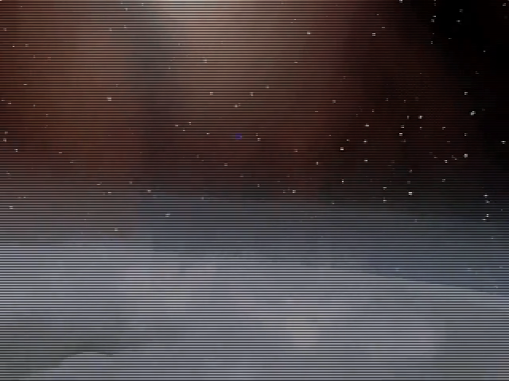
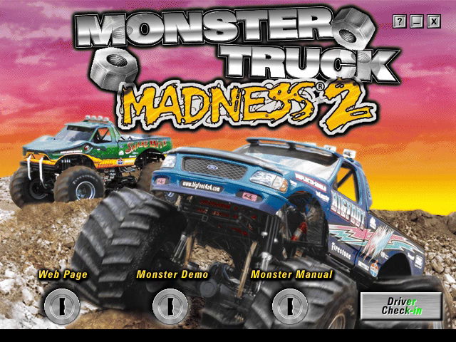
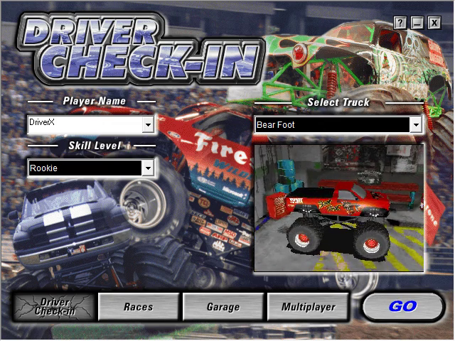
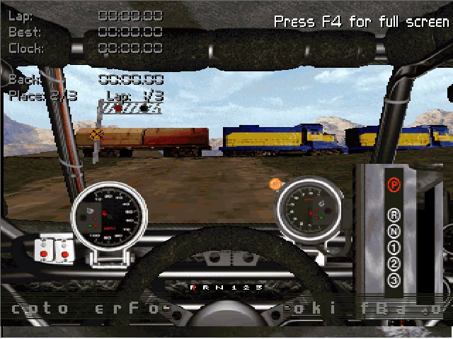

# Monster Truck Madness — Static Recompilation

Static recompilation of **Monster Truck Madness 2** (Microsoft / Terminal
Reality, 1998) from its shipping Win32 binary to native C, on the
[pcrecomp](https://github.com/sp00nznet/pcrecomp) toolchain. Monster Truck
Madness 1 (1996) is next, once MTM2 races.

Part of the pcrecomp collection and its shared house style; siblings from the
same engine house are [fury3](https://github.com/sp00nznet/fury3) and
[hellbender](https://github.com/sp00nznet/hellbender).

## Status: alpha — a race starts

`Monster.exe` is lifted whole (22,279 functions, 0 lift errors, 2.46M lines of
C) and runs on pcrecomp's `native32` host. It plays both intro videos, goes
through the title menu and Driver Check-in, and starts a race on the
software renderer, windowed: the track, the cockpit and the race clock run.
Driving it has not been tried yet.

| Milestone | State |
|---|---|
| Catalog + lift, 0 errors | done |
| Boots: CRT, WinMain, window, `.pod` mounts, `monster.ini` | done |
| Smacker intro videos (MS logo, TRI logo) | done |
| Title menu (MFC + GDI) | done |
| Driver Check-in (3D truck preview), GO, "Before You Begin" | done |
| A race on the software renderer (windowed, GDI) | starts; not driven yet |
| Text strip along the bottom of the race screen | garbled |
| Hardware renderers (`TRID3D.DLL`, Glide) | not started |

Needs pcrecomp [#81](https://github.com/sp00nznet/pcrecomp/pull/81) (thunk
tables in `disasm32`); without it the run faults on the first call through a
thunk the catalog missed.

## Screenshots

From a headless recording (`--headless --record`):

| Intro | Title menu |
|---|---|
|  |  |
| **Driver Check-in** | **Race (Bear Foot, cockpit view)** |
|  |  |

## Getting Started

You need your own Monster Truck Madness 2 disc or an ISO of it. Nothing from
the game is in this repo, and nothing is downloaded.

### Step by step

Prerequisites: Windows 10/11, Python 3.10+ with `capstone` (`py -3 -m pip
install capstone`), Visual Studio 2022 or its Build Tools with the C++ x86
tools, CMake 3.20+, Ninja, and `ffmpeg` on PATH for `--record`.

1. Clone this repo and pcrecomp side by side, pcrecomp on a commit that has
   #81:
   ```
   git clone https://github.com/sp00nznet/mtm
   git clone https://github.com/sp00nznet/pcrecomp
   ```
2. Copy the game off your disc into `game\`:
   ```
   py -3 tools\gamefiles.py "Monster Truck Madness 2.iso"
   ```
   It prints `85 files in ...\game`.
3. Catalog and lift (about 2 and 1 minutes):
   ```
   py -3 tools\catalog.py
   py -3 run_lift.py
   ```
   The lift ends with `lifted 22279   errors 0`.
4. Build: `build.cmd` (MSVC x86 + Ninja) gives `build\mtm.exe`.
5. Run it headless with a recording. This clicks Driver Check-in, then GO,
   then ENTER for "Before You Begin", and the race starts at about 80 s:
   ```
   build\mtm.exe --run --headless --watchdog 120 --record out.mp4 --click 560,433@60000 --click 570,430@68000 --key ENTER@78000
   ```

Use `py` rather than `python`: the Microsoft Store alias answers `python` and
does nothing. A Quick start (`Setup.cmd`) is not written yet; see
[ROADMAP.md](ROADMAP.md).

## Usage

```
mtm [--run] [--headless] [--record out.mp4] [--frames N] [--shot N:file.bmp]
    [--key NAME@MS[+HOLD]] [--click X,Y@MS] [--game game] [--watchdog S]
    [--native-trace] [--callbacks] [--ddraw-trace]
```

Without `--run` it only maps and binds the image (a dry run). `--headless`
draws nothing on screen; `--record` pipes frames to ffmpeg at 30 fps.

## Building from source

`build.cmd` builds locally. Day to day the build runs on the
[recomp-netlab](https://github.com/sp00nznet/recomp-netlab) farm with
`netlab build mtm` (recipe `projects/mtm.env`).

[docs/architecture.md](docs/architecture.md) has the pipeline and what the
host changes about the game's world.

## What is not in this repo

The game, its data and anything derived from its binary: the function
catalog, the lifted C (`src/recomp/gen/`) and run logs are generated
locally into gitignored folders and never committed.

## License

The code and documentation here are MIT. [LICENSE](LICENSE) spells out that
the grant stops at our own work and does not reach the game or anything
lifted from it. Monster Truck Madness © 1996 and Monster Truck Madness 2 ©
1998, Microsoft / Terminal Reality.
